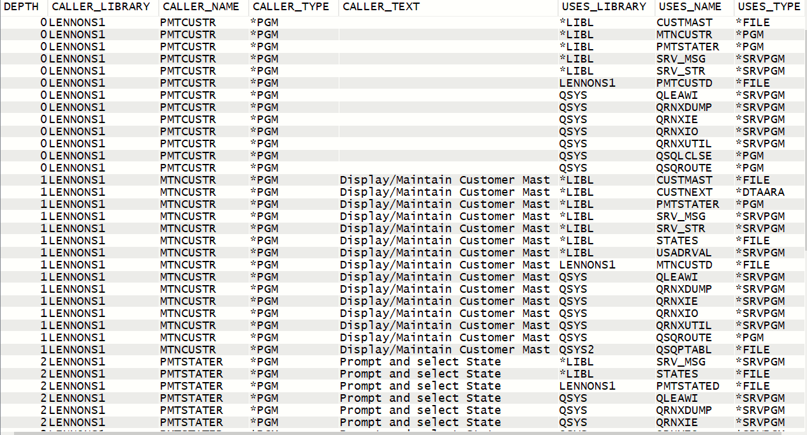

# SQL Procedure to find Program Usage recursively using DSPPGMREF

Given a program (or any of the objects that DSPPGMREF handles), the PGM_REFS stored procedure will find all the obects that the program uses, and then recursively finds all that objects that they use, and so on, to an essentally unlimited depth.

This is the product of my experimentation with SQL Procedures Language (SQL PL). It may be short on error handling, and it doesn't do any validity checking on the parameters. But since I expect you are a developer, you can probaly live with that. Or improve it.

If you have more experience than me, please feel free to suggest better coding techniques.

So far I have not found a decent manual or turorial. If you know of any please pass them on. 

My primary approach was trial and error, with help
from these articles on IT Jungle:
    [Ted Holt Article 1](https://www.itjungle.com/2016/09/27/fhg092716-story02/) and
    [Ted Holt Article 2](https://www.itjungle.com/2016/10/18/fhg101816-story03/) and
    [Ted HolT Article 3](https://www.itjungle.com/2017/06/12/guru-error-handling-sql-pl-part-1/) and 
    [Ted Holt Article 4](https://www.itjungle.com/2017/10/16/guru-error-handling-sql-pl-part-2/)
and browsing [Scott Forstie Gists on Github](https://gist.github.com/forstie
)

In no way does this replace a real cross reference utilily, such as Hawkeye
or X-Analysis. If you don't have one, this *might* be somewhat useful.

## pgm_refs_init.sql

Run this first. `PGM_REFS_INIT(p_RefsLib)` creates (or resets) the `REFS`
and `PGM_REFS_VISITED` tables in whatever library you pass it, e.g.
`call pgm_refs_init('LENNONSB');`. No more hand-editing a library name
into the DDL.

## pgm.refs_Tbl.sql

Deprecated - kept only for reference. This was the original manual DDL
for the REFS table, with the library name hardcoded; use
`pgm_refs_init.sql` instead.

## pgm_refs.sql
This is the code to create the PGM_REFS procedure.

## pgm_refs_test.SQL

These are some samples of calling the procedure to test it. I used iACS Run SQL Scripts. You could also call it in a CL program using the RUNSQLSTM command. (Or run it in STRSQL.)

## Running

### Parameters
See pgm_refs_test.sql for some sample call.

You need to supply library and name. The type will default to `*PGM`, the depth will default to `0`, and the REFS library will default to `CURRENT_SCHEMA` if not supplied.

## Fork enhancements

This fork makes two changes to the original procedure:

1. **Parameterized REFS library.** `p_RefsLib` is a new parameter on
   `PGM_REFS` (defaults to `CURRENT_SCHEMA`). Combined with
   `pgm_refs_init.sql`, you never need to hand-edit a library name into
   the SQL again.

2. **Memoization.** A new `PGM_REFS_VISITED` table records every
   object `PGM_REFS` has already expanded with `DSPPGMREF` in the
   current run. On entry, the procedure checks this table first and
   returns immediately if the object was already visited - so it
   never runs `DSPPGMREF` twice on the same object.

   The original relied only on the `REFS` table's primary key to
   dedupe individual *edges* (a specific caller/callee pair). That
   still let the same *object* get re-expanded with a fresh
   `DSPPGMREF` call every time it was reached by a different parent
   ("diamond" shaped dependencies - e.g. two programs both calling the
   same service program) or via a genuine cycle. On a real system
   with shared service programs this could mean re-running the
   (relatively slow) `DSPPGMREF` command on the same object many
   times. Now it runs once per object per run.

   `p_MaxDepth` (default `999`) is also new: a hard cap on recursion
   depth, as a second safety net for very deep or unexpectedly cyclic
   object graphs, on top of the cycle protection memoization already
   gives you.

   Note: `DROP TABLE ... IF EXISTS`, used in `pgm_refs_init.sql`,
   needs IBM i 7.3/7.4 with the relevant Db2 for i PTF group (Oct 2020
   or later), or 7.5+.

   This has been reviewed carefully but **not run against a live IBM i
   system** - I don't have one set up. Please test on PUB400 or your
   own system before relying on it, and report back if you hit
   anything.

### Library list

Since many objects will have a library of `*LIBL`, that is what will get passed to DSPPGMREF for expansion. So you need to make sure your library list contain all libraries whose objects you want expanded.

### DSPPGMREF Failure

If DSPPGMREF fails internally, `*ERROR` will appear in the three `USES_*` fields in the REFS file. If you get a lot of these check you have your library list correct.

## Sample Output File Contents

## Debugging

I had difficulty debugging this. 

1. I was working on PUB400.COM and the System Debugger in iACS shows the source, but it would never stop on breakpoints. You can debug on the green screen but it isn't as convenient.
2. The DSPPGMREF outfiles are in QTEMP. You can make a single change to put them in one of you libraries if you want to look at them. You will also have to comment out the delete at the bottom of the loop.
